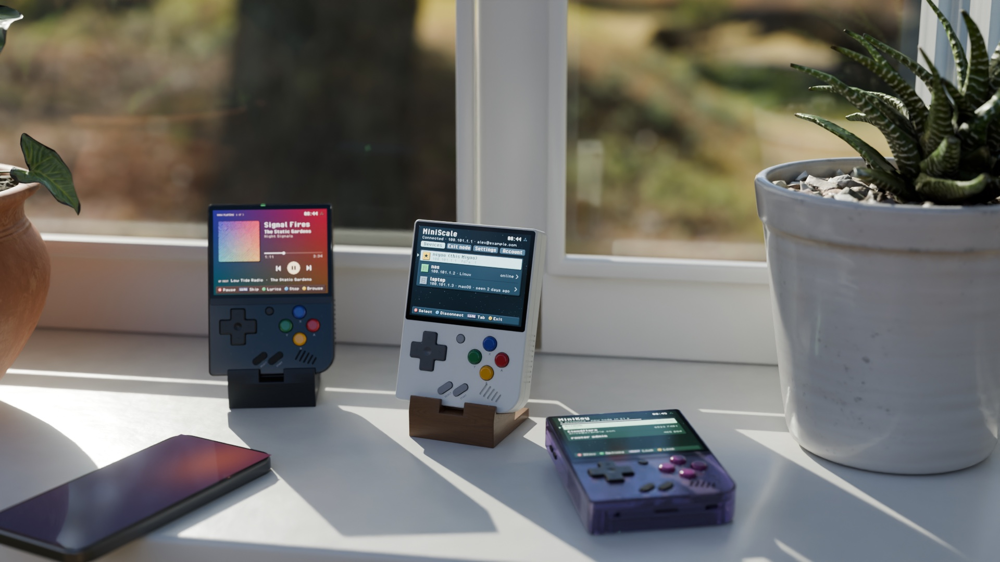
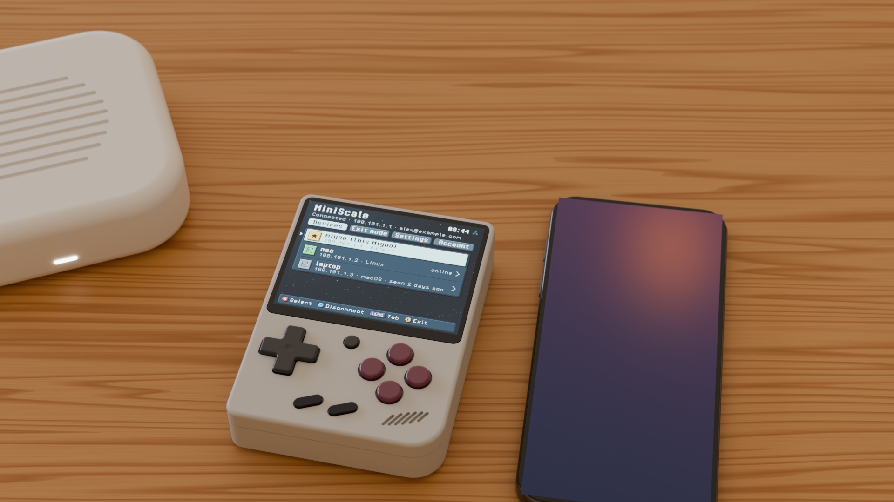

<p align="center"></p>

[](https://github.com/zakijss/MiniScale/actions/workflows/ci.yml)
[](https://github.com/zakijss/MiniScale/releases)
[](LICENSE)

# MiniScale

An unofficial Tailscale client for the Miyoo Mini Plus, which also works with your own [Headscale](https://headscale.net) server or a plain WireGuard server. It puts the device on your network, so the other MiniDeck apps (and your own) can reach the servers on it, and it works like the Tailscale apps on a phone. Part of [MiniDeck](https://github.com/zakijss/MiniDeck).

- Log in by scanning a QR code with your phone; connects by itself at boot.
- Devices with their addresses, connection type and ping; exit nodes; subnet routes; Tailscale DNS and SSH; shields up; several accounts.
- Taildrop: files sent to the Miyoo land in `Media/Taildrop`.
- A status icon in the Onion menu.
- Your own server: log in to Headscale (or another Tailscale-compatible server) with the same QR code, or connect to a plain WireGuard server from a `.conf` file.
- Tailscale 1.104.6 built from source down to 18.9 MB, with its state on the card only encrypted, with a key kept in the device's own flash.


<p align="center"></p>

## Using it

Open **Apps > MiniScale** and press **A**.

- **L1**/**R1** switch between Devices, Exit node, Settings and Account; **L2**/**R2** jump to the top and the bottom of the list.
- **A** opens a device, picks an exit node or changes a setting; on a device, **X** pings it and **Y** uses it as the exit node.
- **X** connects and disconnects; **Y** on the Account tab removes another account.
- **SELECT** changes the look. If Tailscale stops answering, **A** restarts it.

The Devices tab counts how many devices are online, and files sent with Taildrop are announced at the top until the next press.

The device has no TUN interface, so Tailscale runs in userspace mode and other programs reach the tailnet through it: through its SOCKS5 proxy (`127.0.0.1:1055`) or HTTP proxy (`127.0.0.1:1056`), as the MiniDeck apps do, or through a port forward for apps that can't use a proxy. List forwards in `App/MiniScale/forwards.conf`:

```
8096  homeserver:8096      # Jellyfin
```

Settings that apply before the first login (the device name, Tailscale SSH, the proxy ports) are in `App/MiniScale/miniscale.conf`. With MiniScale on, the CLI is `/tmp/miniscale/tailscale --socket=/tmp/miniscale/tailscaled.sock`.

### Headscale

When you log in or add an account, pick **Your own server** and type its address (for example `hs.example.com`). The QR code then opens your server's login page; with Headscale, approve the device there or with `headscale nodes register`. Each account remembers its server, and the Account tab shows it.

### WireGuard

For a plain WireGuard server (a router, wg-easy, a VPS), MiniScale runs WireGuard in userspace behind the same proxies, so the other apps work unchanged.

1. Make a config for the Miyoo on your server (the usual `wg-quick` `.conf` with an `[Interface]` and a `[Peer]`).
2. Copy it to the top of the SD card or to `App/MiniScale`, or send it with Taildrop.
3. In MiniScale, choose **Settings > Network** (or **Y** while MiniScale is off), then **Import a config**, and connect.

MiniScale keeps the config encrypted with the device key, like the Tailscale login, and offers to remove the plain file, which holds the private key. Connections to the addresses in a peer's `AllowedIPs` go through WireGuard and the rest go out directly, so a full-tunnel config (`0.0.0.0/0`) sends everything through your server. Only TCP goes through the proxies. **Use Tailscale instead** on the WireGuard screen switches back; both logins stay saved.

MiniScale is not made or supported by Tailscale Inc.

## Install

- **MiniMart:** open [MiniMart](https://github.com/zakijss/MiniMart), then **Apps > MiniScale**. It checks the download and keeps your settings on updates.
- **Zip:** download `miniscale-VERSION.zip` from [Releases](https://github.com/zakijss/MiniScale/releases/latest), unzip it onto the root of the SD card, and restart.
- **Every MiniDeck app at once:** [minideck-all.zip](https://github.com/zakijss/MiniDeck/releases/latest/download/minideck-all.zip).

## Requirements

A Miyoo Mini Plus on Onion OS 4.4, with Wi-Fi. A Tailscale account, a Headscale server, or a WireGuard server. Other devices and firmwares aren't supported.

## Building

```sh
make check                     # vet, tests, scripts
make package VERSION=1.0.0     # dist/: the release zip, app.json, SHA256SUMS
make deploy HOST=root@miyoo    # build and copy to a device over SSH
```

Go runs in Docker unless you pass `GO=go` (Go 1.27). The interface, themes and networking come from the [MiniDeck library](https://github.com/zakijss/MiniDeck); see its [development notes](https://github.com/zakijss/MiniDeck/blob/main/docs/DEVELOPMENT.md) and [contributing guide](https://github.com/zakijss/MiniDeck/blob/main/CONTRIBUTING.md).

## License

[MIT](LICENSE). Third-party components are listed in [NOTICE](NOTICE). Not made by or affiliated with Miyoo.
